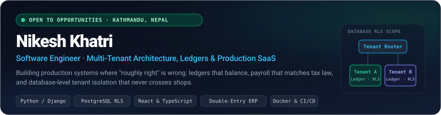

<div align="center">



<br/>
<br/>

[](https://nikeshkhatri.com.np)
&nbsp;
[](https://www.linkedin.com/in/nikesh-khatri-2b04582a9/)
&nbsp;
[](mailto:khatrinikace@gmail.com)
&nbsp;
[](https://nikeshkhatri.com.np)

</div>

---

### 🏛️ Engineering at a Glance

Software engineer based in **Kathmandu, Nepal** building production SaaS, ERP, and operational platforms where *"roughly right"* is wrong: **payroll** that must legally reconcile with tax authorities, **double-entry ledgers** that have to balance, and **multi-tenant data** that must never cross shops.

| Dimension | Scope & Evidence | Production Highlights |
| :--- | :--- | :--- |
| **🚀 Products Shipped** | **17+ Systems Delivered** | ERP, Multi-Tenant Retail SaaS, GovTech, Biometric Attendance, Audio Streaming |
| **⚙️ Daily Stack** | **Python, Django, React, TypeScript** | REST APIs, PostgreSQL RLS, Celery, Docker, Automated Test Pipelines |
| **🛡️ Architecture Focus** | **Isolation & Correctness** | Row-Level Security (RLS), Double-Entry Accounting, IRD/CBMS VAT Compliance |
| **📍 Location & Status** | **Kathmandu (UTC+05:45)** | Software Engineer @ Goodwish Engineering · Open to high-impact roles |

---

### 📦 Featured Production Systems

> [!NOTE]
> **A Note on Source Code Visibility:**
> Most of my production systems were commissioned by enterprise clients or built in private employer repositories. To provide complete transparency into my architectural decisions, full write-ups, schema notes, and interactive walkthroughs are published on **[nikeshkhatri.com.np](https://nikeshkhatri.com.np)**.

#### 🛍️ [Mero Pasal](https://mero-pasal.online) — *Multi-Tenant Retail SaaS for Nepali Shops*
- **Role:** Sole Engineer (Architecture, Django REST Framework backend, React frontend, Docker deployment).
- **Core Architecture:** Database-level tenant isolation enforced with **PostgreSQL Row-Level Security (RLS)** — preventing data crossover even if application queries omit tenant scoping.
- **Key Modules:** Storefront generation, point-of-sale invoicing, IRD/CBMS-oriented VAT billing, and *Khata* (customer credit tracking with ledger trails).
- **Stack:** `Python` · `Django` · `DRF` · `PostgreSQL (RLS)` · `React` · `TypeScript` · `Docker` · `Caddy`

#### 🧵 [Garment Manufacturing ERP](https://nikeshkhatri.com.np) — *Order-to-Ledger Factory Operating System*
- **Role:** Sole Engineer (516 commits, 159 merged pull requests).
- **Core Architecture:** A **ledger-first double-entry engine** where every commercial action (raw material purchase, cutting ticket, rework, dispatch) atomically writes balanced journal entries directly to the general ledger.
- **Key Modules:** Merchandising, Work-In-Progress (WIP) tracking with barcode logging, piece-rate SAM payroll, VAT billing, and Bikram Sambat date calculations.
- **Tech:** `Django` · `PostgreSQL` · `Celery` · `Redis` · `React` · `Tailwind CSS` · `ReportLab` · `Playwright`

#### 🏛️ [Digital File Tracking System (FTS)](https://nikeshkhatri.com.np) — *GovTech Workflow Automation*
- **Role:** Full-Stack Engineer for a Nepali public enterprise.
- **Core Architecture:** Transitioned a paper-bound bureaucracy into an immutable, auditable digital workflow enforcing strict hierarchical permission boundaries.
- **Key Modules:** *Darta* (inward registration), *Chalani* (dispatch), *Tippani* (internal executive minute routing), and *Tameli* (archival).
- **Tech:** `Django 5.2` · `PostgreSQL 16` · `DRF` · `Docker` · `Tailwind CSS`

#### 🅿️ [Bayline Parking Platform](https://nikeshkhatri.com.np) — *Multi-Tenant Parking & Revenue Operations*
- **Role:** Full-Stack Delivery across web, mobile, and hardware gateways.
- **Key Modules:** Real-time bay occupancy, barrier gate check-in, Khalti payment gateway integration, thermal ticket printing, and revenue auditing.
- **Tech:** `Django` · `DRF` · `React` · `PostgreSQL` · `Redis` · `Khalti API`

---

### 📝 Architecture Notes & Technical Deep Dives

I write in-depth technical case studies breaking down real engineering tradeoffs:

- 📖 **[Tenant Isolation with PostgreSQL RLS](https://nikeshkhatri.com.np/notes/tenant-isolation-postgres-rls)**
  *Why application-level `WHERE tenant_id = ?` clauses inevitably leak in complex joins, and how to use Postgres connection-scoped session variables and RLS policies to guarantee tenant isolation at the database layer.*
- 📖 **[A Ledger-First ERP Architecture](https://nikeshkhatri.com.np/notes/ledger-first-erp)**
  *Why treating accounting as a reporting view built on top of invoices fails on credit notes and reversals — and how placing balanced journal entries at the center makes the trial balance the source of truth.*

---

### 🛠️ Technical Skillset & Tooling

```
Languages & Core     :: Python · TypeScript · JavaScript · SQL (PostgreSQL, MySQL)
Backend & APIs       :: Django · Django REST Framework · NestJS · Node.js · Celery · WebSockets · OpenAPI
Frontend             :: React · Next.js · Vite · Tailwind CSS · Redux Toolkit · PWA
Data & Architecture  :: PostgreSQL (RLS) · Redis · Prisma · Relational Modeling · Double-Entry Ledgers
Cloud & Operations   :: Docker · Nginx · Caddy · GitHub Actions · CI/CD · Linux · GCP Storage
Quality & Testing    :: Pytest · Vitest · Playwright · Automated Regression Suites
Domain Competencies  :: IRD / CBMS Invoicing · Nepal Tax Slabs · SSF/SST Payroll · Bikram Sambat (BS)
```

<br/>

<div align="center">

| Category | Technologies |
| :--- | :--- |
| **Backend & APIs** |       |
| **Database & Architecture** |     |
| **Frontend** |     |
| **DevOps & Testing** |      |

</div>

---

### 🧠 Engineering Principles

- ⚖️ **Correctness before cleverness** — Payroll that is off by one rupee is broken. A ledger that does not balance is broken. In finance-sensitive and permission-sensitive systems, boring, verifiably correct code with rigorous test coverage always beats clever shortcuts.
- 🎯 **Own the problem, not just the ticket** — Requirements, schema design, test suites, deployment configuration, and the late-night production diagnostic are all one responsibility. I follow features through to where real users rely on them without complaint.
- 📐 **Learn the domain, not just the framework** — Tax slabs, SSF/SST deductions, Darta/Chalani conventions, SAM piece-rate costing — none of these are in framework documentation. I study the actual statutory rules and translate them into intuitive software.
- ⚡ **AI as an accelerator, not an author** — AI tools excel at research, scaffolding, and test permutations. Every line committed is scrutinized, understood, and owned by the engineer.

---

### 📈 Activity & Streak

<div align="center">


</div>

---

### 📬 Let's Connect

Whether you're looking for a software engineer to own critical backend architecture, build multi-tenant SaaS products, or discuss complex ledger systems — I'd love to talk.

<div align="center">

[](https://nikeshkhatri.com.np)
&nbsp;
[](https://www.linkedin.com/in/nikesh-khatri-2b04582a9/)
&nbsp;
[](mailto:khatrinikace@gmail.com)
&nbsp;
[](https://nikeshkhatri.com.np/resume)

</div>
